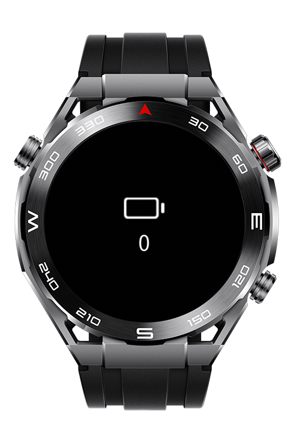
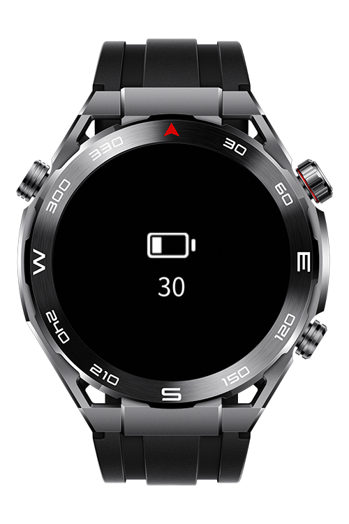
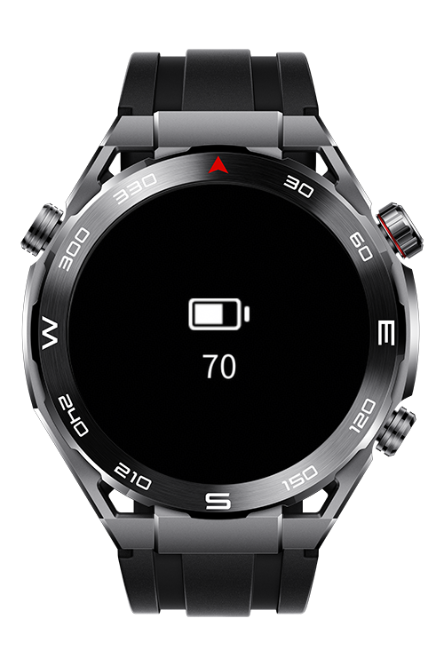

> **Note:** To access all shared projects, get information about environment setup, and view other guides, please visit [Explore-In-HMOS Index](https://github.com/Explore-In-HMOS/hmos-index).

# How To Implement Battery Indicator
A lightweight wearable-friendly battery indicator codelab built for Huawei Lite Wearable devices.  
Designed to demonstrate battery indicator implementation, usage of @system.battery, and to make various battery icons accessible.

# Preview

<div>
  
  
  
  
</div>

# Use Cases
- Read the current battery level from the system battery service
- Display the level as a rounded percentage (0 to 100)
- Show a battery icon matched to the level in 10% steps
- Adapt the battery icon to the active theme (Light / Dark)
- Log a clear error when the battery status cannot be read

# Tech Stack
- **Languages**: HML, JS, CSS
- **Frameworks**: 6.1.1(24)
- **Tools**: DevEco Studio Version 6.1.1
- **Libraries**: @system.battery

# Directory Structure

```
entry/
└── src/main/js/MainAbility/
    ├── app.js
    ├── common/
    │   ├── helpers/
    │   │   └── batteryHelper.js
    │   └── icons/
    │       ├── dark/
    │       │   └── battery_0.png ... battery_100.png
    │       └── light/
    │           └── battery_0.png ... battery_100.png
    └── pages/
        └── index/
            ├── index.css
            ├── index.hml
            └── index.js
```

# Constraints and Restrictions

## Supported Devices

* Huawei Sport (Lite) Watch GT 4/5/6
* Huawei Sport (Lite) GT4/5 Pro
* Huawei Sport (Lite) Fit 3/4
* Huawei Sport (Lite) D2
* Huawei Sport (Lite) Ultimate
* DevEco Studio Simulator

# LICENSE
How to implement battery indicator is distributed under the terms of the MIT License.
See the [LICENSE](./LICENSE) for more information.